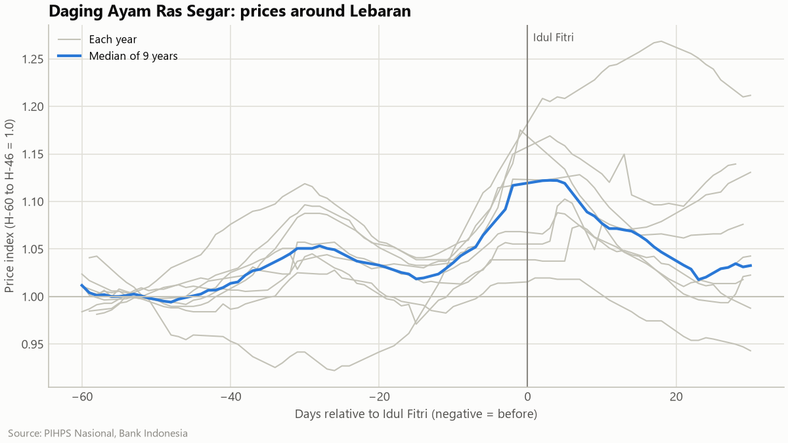
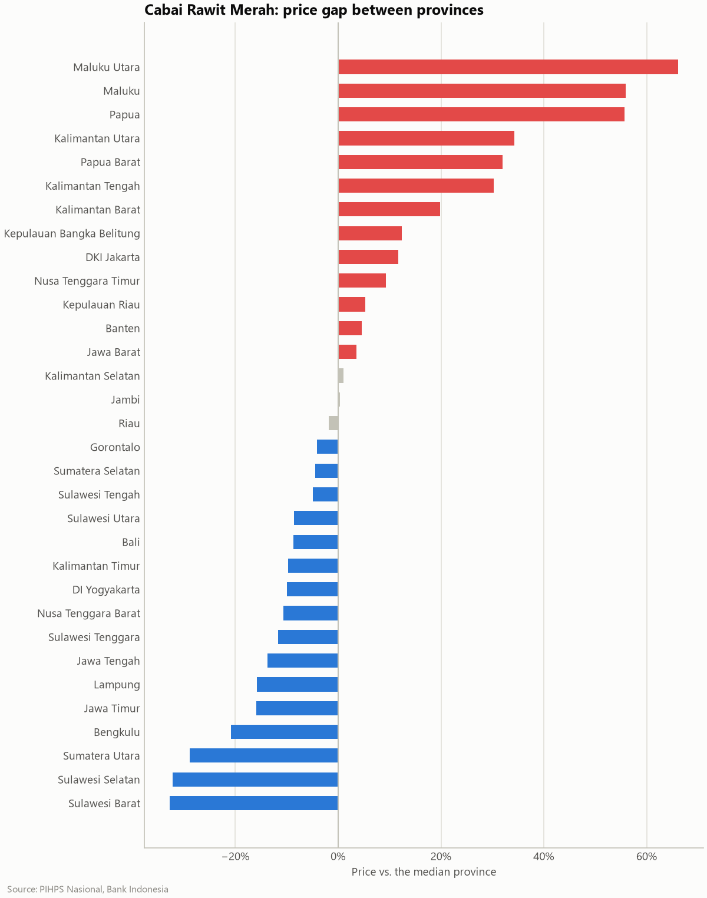
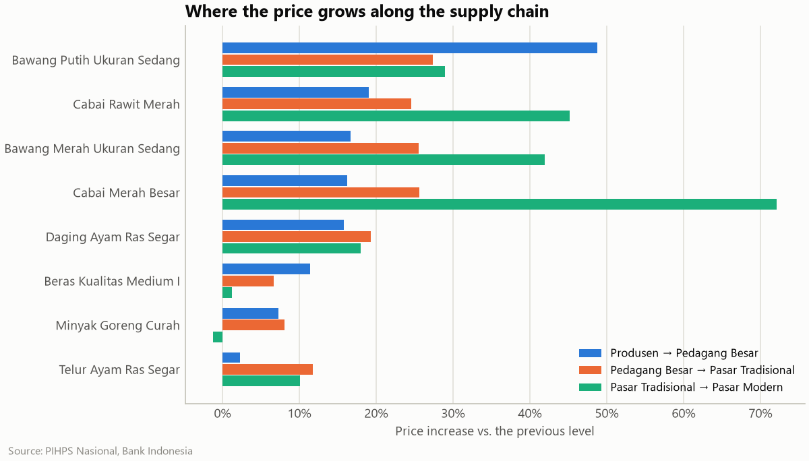

# Harga Pangan Indonesia — when, where and from whom to buy staple food

**1.7 million daily food prices · 34 provinces · 21 commodities · 2018–2026**
SQL (DuckDB) · Python (pandas, SciPy, matplotlib) · Tableau Public

> 📊 **Interactive dashboard:** `TABLEAU_PUBLIC_URL` <!-- TODO: replace with the Tableau Public link -->

## The question

*Scenario (fictional):* a catering chain buys rice, chillies, shallots, chicken, eggs, oil and
sugar in every Indonesian province. Its procurement team asks four questions:

1. **When** should we stock up — how much do prices rise around Lebaran, and when?
2. **What** should we lock into fixed-price contracts — which prices swing the most?
3. **Where** is food expensive — and is the gap between provinces closing?
4. **From whom** should we buy — how much does the price grow from producer to market?

The data is Bank Indonesia's **PIHPS Nasional** (strategic food price information centre):
daily prices from traditional markets in 34 provinces, plus national series for producers,
wholesalers, traditional and modern markets.

## Key findings

| | Finding |
|---|---|
| 🌙 **Lebaran** | Only protein rises reliably: **chicken +12.8%** (95% CI 7.5–17.5%) peaking in Lebaran week, **eggs +8.1%** a week earlier. Rice, oil and sugar move less than 4%. Chillies spike every season (+17.7% median) but the timing is driven by weather, not Lebaran (CI −4.5% to +52%). |
| 📈 **Volatility** | Chillies swing **17–30× more than rice** (8.5% a week for *cabai rawit merah* vs ~0.3%). Biggest 4-week shock: *cabai rawit merah* **+125.5%** in December 2021. The data also shows the 2022 cooking-oil crisis (+31–35%) and the February 2024 rice surge (+6.2%). |
| 🗺️ **Regions** | Eastern Indonesia (WIT) pays more for **all 21 commodities**: chillies +52%, shallots +39%, eggs +26%, rice +14% vs the median province. Papua is 1.28× the median overall; Sulawesi Selatan is the cheapest (0.86×). The gap is **closing for eggs and rice** (Spearman ρ = −0.77 and −0.74) but **not for chillies**. |
| 🚚 **Supply chain** | From producer to traditional market, chillies gain **+46% to +60%**, rice only +15–21%. The wholesaler-to-market step alone adds 16–29% for chillies and shallots. Modern retail charges **+42–72%** more than traditional markets for fresh chillies and shallots, but about the same for packaged oil and sugar. |



## Recommendations

| Decision | Recommendation |
|---|---|
| Timing | Contract chicken and eggs **at least two weeks before Lebaran**; don't stockpile rice, oil or sugar for it. |
| Contracts | Put chillies and shallots under **fixed-price / forward contracts** or keep recipes flexible. |
| Budget | Plan **13–28% higher food cost** for eastern branches (Maluku 1.13× … Papua 1.28×); source chillies from Sulawesi Selatan/Barat or Sumatera Utara (~30% below median). |
| Channel | Buy fresh produce from **wholesalers (pedagang besar)**, never modern retail; packaged goods can come from either. |

<p>
  
  
</p>

## Data quality — what the real data needed

Tests passed on the first version of the pipeline, but the real data still hid three problems.
Each was found by inspecting results, reproduced in a failing test, then fixed:

| Problem in the source | Symptom | Fix |
|---|---|---|
| Server sometimes answers `200 OK` with an empty body | download crashed at job 66 of 342 | treat it as transient and retry with backoff |
| A beef producer price typed as Rp583k instead of Rp108k for **22 business days** | the typo became the *monthly* median, so correct prices were flagged | outliers judged against a **±60-day rolling median** (33 prices flagged) |
| On holidays only 1–2 of 34 provinces report, yet a "national" price is published | a fake +13% rice spike at Lebaran 2022 | days with < 50% of provinces reporting are dropped from the national series (77 weekdays) |

Coverage is high: every province-year has prices on ≥ 92% of business days. Details:
[`notebooks/01_data_quality.ipynb`](notebooks/01_data_quality.ipynb) and
[`docs/DATA_SOURCES.md`](docs/DATA_SOURCES.md).

## How it works

```
PIHPS JSON endpoints ──► extract.py ──► data/raw/ (cached JSON, resumable)
   (Bank Indonesia)      polite: 1 request at a time, 2 s pause, retries
                                 │
                         transform.py   wide → long, "16,150" → 16150, dd/mm/yyyy
                                 │
                         warehouse.py ──► DuckDB star schema
                                          fact_price_daily (1.71M rows)
                                          dim_date · dim_province · dim_commodity · dim_market_type
                                 │
                         sql/marts/*.sql  one file per business question
                                 │        (CTEs, window functions, rolling medians, QUALIFY)
               ┌─────────────────┼──────────────────┐
     notebooks/02_analysis   reports/figures   exports/tableau/*.csv ──► Tableau Public
```

The SQL is the heart of the analysis — start with
[`sql/marts/q1_lebaran.sql`](sql/marts/q1_lebaran.sql) and
[`sql/marts/q3_disparity.sql`](sql/marts/q3_disparity.sql).

## Run it yourself

Requires [uv](https://docs.astral.sh/uv/) (Python 3.13 is installed automatically).

```bash
uv sync
uv run pangan all        # extract → build → marts → export
uv run pangan quality    # data-quality report
uv run pytest            # 76 tests
```

The first `extract` downloads 342 yearly files (~2.5–4 h, the server is slow); it caches every
file and resumes where it stopped. Individual steps: `uv run pangan {extract,build,marts,export}`.

## Repository layout

```
src/pangan/        pipeline: client, extract, transform, warehouse, marts, export, plots, cli
sql/               schema, cleaning rules, marts (analysis) and Tableau exports
notebooks/         01 data quality · 02 analysis (findings + statistics)
exports/tableau/   10 CSVs the dashboard is built from
reports/figures/   charts used here and in the notebooks
docs/              data sources, Tableau build guide, explainer (Bahasa Indonesia)
tests/             pytest suite on synthetic data with hand-checked numbers
```

## Limitations

- PIHPS national series are averages of the markets that report; prices are business days only.
- Ramadan is approximated as the 30 days before Idul Fitri; with 9 seasons the Lebaran confidence
  intervals are wide.
- Statistics are descriptive (bootstrap CIs, Spearman trends) — no causal claims.
- PIHPS has no official API; the extractor uses the portal's own JSON endpoints and is
  deliberately slow and cached.
- **Work in progress:** food basket vs. provincial minimum wage (UMP) awaits BPS reference data.

## Sources

Price data: **PIHPS Nasional, Bank Indonesia** (<https://www.bi.go.id/hargapangan>).
Minimum wage and consumption reference data: **Badan Pusat Statistik (BPS)**.
Idul Fitri dates: Kementerian Agama (sidang isbat).
